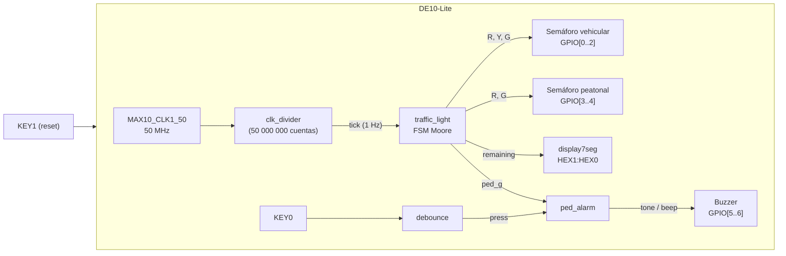
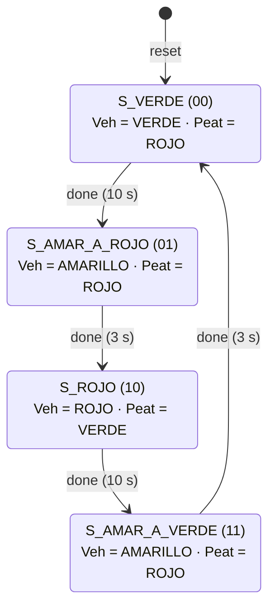
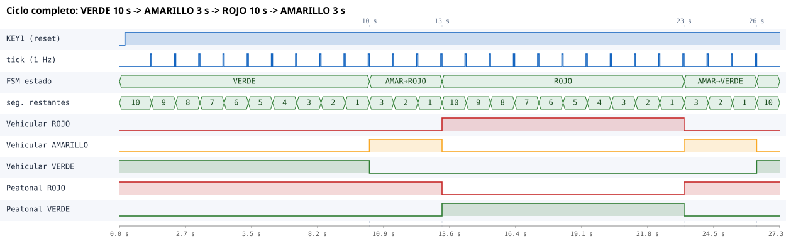
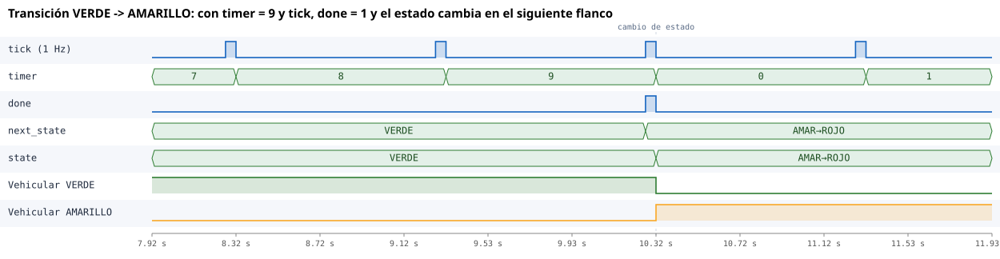
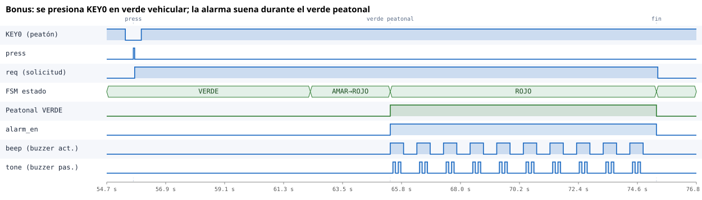

# Informe Lab 05: Máquinas de Estados — Semáforo vehicular y peatonal en FPGA (DE10-Lite)

**Universidad ECCI**
**Facultad de Ingeniería — Electrónica Digital**

**Autor:** Carlos Rafael Herrera Gamarra

---

Máquina de estados finitos **tipo Moore** que controla el semáforo vehicular y el semáforo peatonal de un mismo cruce. Todo corre en la DE10-Lite (MAX 10), sin microcontrolador:

| Semáforo | Luces | Salida |
|---|---|---|
| **Vehicular** | Rojo, amarillo, verde | `GPIO[0..2]` y `LEDR9..LEDR7` |
| **Peatonal** | Rojo, verde | `GPIO[3..4]` y `LEDR1..LEDR0` |

`KEY1` reinicia el sistema. Los displays `HEX1:HEX0` muestran los segundos que faltan en el estado actual.
**Bonus:** si se presiona `KEY0`, un buzzer pita durante el siguiente verde peatonal.

---

## 1. Estructura del repositorio

```
semaforo.v          Módulo superior: integra todo y asigna los pines de la DE10-Lite
traffic_light.v     FSM Moore del semáforo (3 bloques always)
clk_divider.v       Divisor 50 MHz -> pulso de 1 Hz
debounce.v          Sincronizador + antirrebote + detector de flanco de KEY0
ped_alarm.v         (Bonus) Solicitud peatonal + generador de tono para el buzzer
display7seg.v       Decodificador BCD -> 7 segmentos
tb_semaforo.v       Testbench autoverificable
sim/
  run_sim.bat         Compila, simula y genera las figuras
  waves.py            Dibuja las formas de onda del VCD en SVG
  tb_semaforo.gtkw    Vista preconfigurada para GTKWave
build/
  tb_semaforo.v.out   Testbench compilado (iverilog)
  tb_semaforo.vcd     Formas de onda (abrir con GTKWave)
docs/img/           Formas de onda de la simulación
semaforo.qpf/.qsf/.sdc   Proyecto de Quartus con los pines asignados
```

---

## 2. Diseño

### 2.1 Diagrama de bloques



### 2.2 Tabla de estados

| Estado | Código | Vehicular R Y G | Peatonal R G | Duración |
|---|---|---|---|---|
| `S_VERDE`        | `00` | 0 0 1 | 1 0 | 10 s |
| `S_AMAR_A_ROJO`  | `01` | 0 1 0 | 1 0 | 3 s  |
| `S_ROJO`         | `10` | 1 0 0 | 0 1 | 10 s |
| `S_AMAR_A_VERDE` | `11` | 0 1 0 | 1 0 | 3 s  |

- El peatón **solo** tiene verde cuando el vehicular está en rojo.
- En los dos amarillos el peatón ve rojo, lo que da tiempo para despejar el cruce.
- El amarillo aparece en las dos transiciones, por eso hay 4 estados (2 flip-flops en binario). Las duraciones son parámetros de `traffic_light` (`T_VERDE`, `T_AMARILLO`, `T_ROJO`).

### 2.3 Diagrama de estados (Moore)

En un diagrama Moore las salidas se escriben **dentro del estado**, y las flechas solo llevan la condición de transición:



`done = tick · (timer = duración − 1)`. Mientras `done = 0`, la FSM se queda en el mismo estado.

### 2.4 Estructura del código (`traffic_light.v`)

La FSM está separada en tres bloques, como pide la guía. Así se evitan latches inferidos:

| Bloque | Tipo | Qué hace |
|---|---|---|
| Registro de estado | `always @(posedge clk)` | `state <= next_state` (y el contador `timer` de segundos) |
| Siguiente estado | `always @(*)` | Con `done = 1` avanza al siguiente estado; si no, `next_state = state` |
| Salidas Moore | `always @(*)` | `case (state)`: las luces dependen **solo** del estado |

Los dos bloques combinacionales empiezan con un valor por defecto (`next_state = state`, todo en rojo). Así todas las salidas quedan asignadas en todos los caminos y Quartus no infiere latches.

### 2.5 Base de tiempo (`clk_divider.v`)

- N = 50 000 000 / 1 Hz = **50 000 000 cuentas** (de 0 a 49 999 999), con un contador de ⌈log₂ 50 000 000⌉ = **26 bits**.
- La salida `tick` es un pulso de **un ciclo** de 20 ns cada segundo. Se usa como habilitación (`if (tick)`) y no como reloj, así que todo el diseño queda en un solo dominio de reloj de 50 MHz.

### 2.6 Bonus: botón peatonal y alarma (`debounce.v`, `ped_alarm.v`)

- `KEY0` pasa por un sincronizador de 2 flip-flops y un antirrebote de 10 ms. Cada pulsación produce **un solo pulso** `press`.
- `press` activa la solicitud `req`, que se ve en `LEDR4`.
- Mientras `req · ped_g = 1`, suena la alarma (`LEDR3`):
  - `beep`: pitidos de 4 Hz para un buzzer **activo** (`GPIO[6]`).
  - `tone`: los mismos pitidos con un tono de 2 kHz para un buzzer **pasivo** (`GPIO[5]`).
- Cuando termina el verde peatonal, `req` se borra. Si nadie presiona el botón, no suena.

---

## 3. Simulación

Requisitos: Icarus Verilog y Python (solo para generar las figuras).

```bat
sim\run_sim.bat          :: compila, simula y genera docs\img\*.svg
sim\run_sim.bat wave     :: además abre GTKWave con las señales cargadas
```

Simular 50 millones de ciclos por segundo sería muy lento. Por eso el testbench usa `CLK_HZ = 20`: un segundo del semáforo equivale a 20 ciclos de reloj. La lógica es la misma que en la placa; solo cambian los parámetros de los divisores. En cada ciclo de reloj el testbench verifica:
- que haya una sola luz encendida en cada semáforo;
- que nunca haya verde peatonal sin rojo vehicular;
- la secuencia y la duración de cada estado.

Resultado:

```
Reset -> inicia en VERDE vehicular / ROJO peatonal         PASS
=== Ciclo normal (2 vueltas, sin boton) ===
t= 10 s  vehicular=AMARILLO peatonal=ROJO  (el anterior duro 10 s)
t= 13 s  vehicular=ROJO     peatonal=VERDE (el anterior duro 3 s)
t= 23 s  vehicular=AMARILLO peatonal=ROJO  (el anterior duro 10 s)
t= 26 s  vehicular=VERDE    peatonal=ROJO  (el anterior duro 3 s)
...
Secuencia, duraciones y seguridad en 2 vueltas             PASS
Sin boton la alarma no suena                               PASS
=== Bonus: boton peatonal ===
t= 55 s  >> el peaton presiona KEY0
Se registra la solicitud (req = 1)                         PASS
No suena antes del verde peatonal                          PASS
La alarma suena durante el verde peatonal                  PASS
Al terminar el verde se borra la solicitud                 PASS
Siguiente vuelta sin boton: silencio                       PASS
Sin errores de seguridad en toda la simulacion             PASS
--------------------------------------------------------------
Cambios de estado verificados: 15
 RESULTADO: 9 pruebas, TODAS PASARON
```

### 3.1 Ciclo completo

Verde 10 s → amarillo 3 s → rojo 10 s → amarillo 3 s. El peatonal está en verde exactamente mientras el vehicular está en rojo, y los segundos restantes bajan con cada `tick`:



### 3.2 Transición de estado

Con `timer = 9` llega el `tick` del décimo segundo: `done` sube durante un ciclo y `next_state` ya vale `AMAR→ROJO`. En el siguiente flanco de reloj, `state` toma ese valor y las luces cambian. Las salidas cambian **junto con el estado**, no con la entrada, como corresponde a una máquina Moore:



### 3.3 Bonus: alarma peatonal

El peatón presiona `KEY0` durante el verde vehicular y `req` queda en 1. La alarma espera hasta que el peatonal pasa a verde, pita durante los 10 s y se apaga al terminar, cuando también se borra `req`:



---

## 4. Implementación en la DE10-Lite

### 4.1 Compilación

Abra `semaforo.qpf` en Quartus (los pines ya están asignados en el `.qsf`) y compile. Después programe `output_files/semaforo.sof` con *Programmer* (USB-Blaster).

Resultado de la compilación (Quartus Prime Lite 25.1, 10M50DAF484C7G):

| Recurso | Uso |
|---|---|
| Elementos lógicos | 204 / 49 760 (< 1 %) |
| Registros | 102 |
| Pines | 36 / 360 |
| Fmax (peor esquina, 85 °C) | 184 MHz (requerido 50 MHz, slack +14,6 ns) |

### 4.2 Asignación de pines

| Señal | Pin | Señal | Pin |
|---|---|---|---|
| MAX10_CLK1_50 | P11 | KEY0 (peatón) | B8 |
| KEY1 (reset) | A7 | | |
| LEDR0…LEDR9 | A8, A9, A10, B10, D13, C13, E14, D14, A15, B11 | | |
| HEX0[0..7] | C14, E15, C15, C16, E16, D17, C17, D15 | HEX1[0..7] | C18, D18, E18, B16, A17, A18, B17, A16 |
| **GPIO[0]** rojo veh. | **V10** | **GPIO[3]** rojo peat. | **W9** |
| **GPIO[1]** amarillo veh. | **W10** | **GPIO[4]** verde peat. | **V8** |
| **GPIO[2]** verde veh. | **V9** | **GPIO[5]** / **GPIO[6]** buzzer | **W8** / **V7** |

### 4.3 Conexión de los semáforos y el buzzer

| Header GPIO (JP1) | Conectar |
|---|---|
| Pin 1: GPIO[0] | LED **rojo** vehicular + 220–330 Ω |
| Pin 2: GPIO[1] | LED **amarillo** vehicular + 220–330 Ω |
| Pin 3: GPIO[2] | LED **verde** vehicular + 220–330 Ω |
| Pin 4: GPIO[3] | LED **rojo** peatonal + 220–330 Ω |
| Pin 5: GPIO[4] | LED **verde** peatonal + 220–330 Ω |
| Pin 6: GPIO[5] | Buzzer **pasivo** (bonus) |
| Pin 7: GPIO[6] | Buzzer **activo** (bonus) |
| Pin 12 (o 30): **GND** | Cátodos de los LEDs y negativo del buzzer |

> ⚠️ Los GPIO trabajan a **3,3 V**: no conecte señales de 5 V. Si el buzzer consume más de unos 8 mA, actívelo con un transistor (p. ej. 2N2222 con 1 kΩ en la base). Si usa un módulo semáforo con resistencias incluidas, conéctelo directo al pin y a GND. Verifique la numeración del header en la figura del manual de la DE10-Lite antes de conectar.

### 4.4 Prueba

1. Programar la placa: el vehicular arranca en verde y el peatonal en rojo, y `HEX1:HEX0` cuenta 10, 9, … 1.
2. Comprobar que la secuencia es verde 10 s → amarillo 3 s → rojo 10 s (peatonal en verde) → amarillo 3 s.
3. Presionar `KEY0` con el vehicular en verde: se enciende `LEDR4` y el buzzer pita durante el siguiente verde peatonal.
4. Presionar `KEY1` para volver al inicio.

---

## 5. Preguntas de análisis

**1. ¿Por qué se usa una máquina Moore y no una Mealy? ¿Cómo cambiaría el diagrama?**
En un semáforo, cada combinación de luces **es** un estado, así que lo natural es que las salidas dependan solo del estado (Moore). Las luces cambian únicamente en el flanco de reloj en que cambia el estado: no tienen glitches y no dependen de que una entrada cambie a mitad de un ciclo. En una Mealy, las salidas se escriben **en las flechas** (`done / luces`), porque dependen del estado y de las entradas. Eso puede ahorrar estados (por ejemplo, un solo estado "amarillo" que decide su salida según de dónde viene), pero las luces podrían cambiar en cuanto cambia la entrada, un ciclo antes que el estado, y la señal de salida sería combinacional.

**2. Flip-flops mínimos para 3 estados y para codificación one-hot. Comparación de recursos.**
- **Binaria:** ⌈log₂ N⌉ flip-flops. Con 3 estados (o los 4 de este diseño) bastan **2 flip-flops**.
- **One-hot:** un flip-flop por estado, es decir, **3** para 3 estados (**4** en este diseño).

Se sintetizó el diseño con las dos codificaciones (`STATE_MACHINE_PROCESSING` en Quartus):

| Codificación | Flip-flops de estado | Registros totales | Elementos lógicos |
|---|---|---|---|
| Binaria mínima (`MINIMAL BITS`) | 2 | 100 | 206 |
| One-hot (`ONE-HOT`, la que Quartus elige en `Auto`) | 4 | 102 | 204 |

One-hot usa más flip-flops, pero simplifica la lógica de siguiente estado y de salida: cada luz sale casi directo de un flip-flop. En una FPGA los flip-flops sobran (hay uno en cada elemento lógico), así que el total queda prácticamente igual. Por eso Quartus usa one-hot por defecto. La diferencia sería más grande en una FSM con muchos estados.

**3. ¿Cómo se agregaría un estado de amarillo intermitente a 1 Hz?**
Se agrega un estado `S_INTERMITENTE` (por ejemplo, un modo nocturno que se activa con un switch `SW0` desde cualquier estado, y que al apagarlo pasa a `S_ROJO`). En ese estado la salida es `car_y = blink`, donde `blink` es un flip-flop que cambia con cada `tick` de 2 Hz (0,5 s encendido y 0,5 s apagado = 1 Hz). Como `blink` es un registro, la salida sigue dependiendo solo de registros y la máquina conserva el comportamiento Moore. El peatonal se dejaría en rojo, o también intermitente.

**4. ¿Qué pasa si la lógica de transición y el registro de estado se escriben en un solo `always @(posedge clk)` con señales combinacionales?**
Todo lo que se asigna dentro de un `always @(posedge clk)` se convierte en flip-flop. Por eso las señales que debían ser combinacionales (`next_state`, `done`, las luces) quedan **registradas y retrasadas un ciclo**: la FSM decide con valores viejos y las salidas llegan un ciclo tarde. Si además se usan asignaciones bloqueantes (`=`) para simular la parte combinacional, el resultado depende del orden de las líneas y la simulación puede no coincidir con la síntesis. Mantener los tres bloques separados deja claro qué es registro y qué es lógica combinacional.

**5. Frecuencia de reloj para que el contador de 10 s no desborde un registro de 20 bits.**
Un registro de 20 bits cuenta hasta 2²⁰ − 1 = 1 048 575. Para contar 10 s con un reloj de frecuencia f se necesitan 10·f cuentas:

10·f ≤ 2²⁰ = 1 048 576 → **f ≤ 104 857,6 Hz ≈ 104,9 kHz**

Es una frecuencia **máxima**: con un reloj más rápido el contador desborda antes de llegar a 10 s. Con los 50 MHz de la placa, 10 s son 500 000 000 cuentas y harían falta 29 bits. Por eso el diseño usa dos contadores: `clk_divider` (26 bits) genera el pulso de 1 Hz, y `traffic_light` cuenta segundos con solo 5 bits (`timer`, hasta 31 s).
