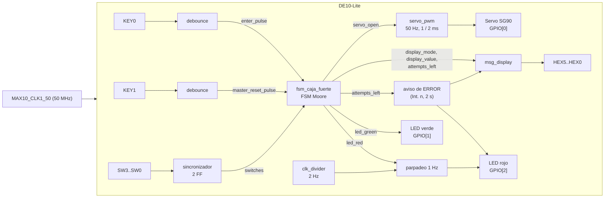
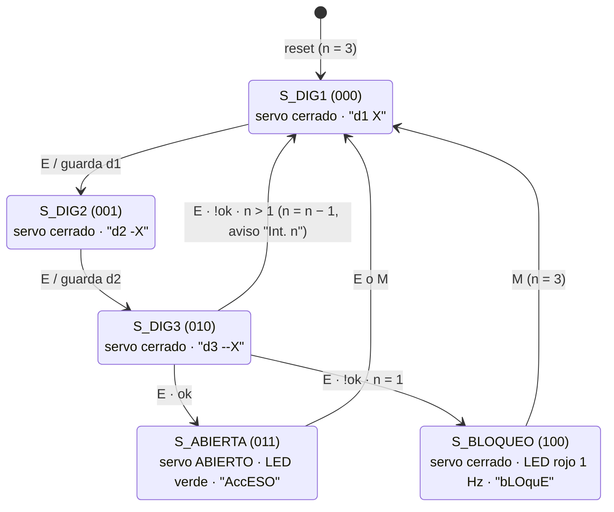
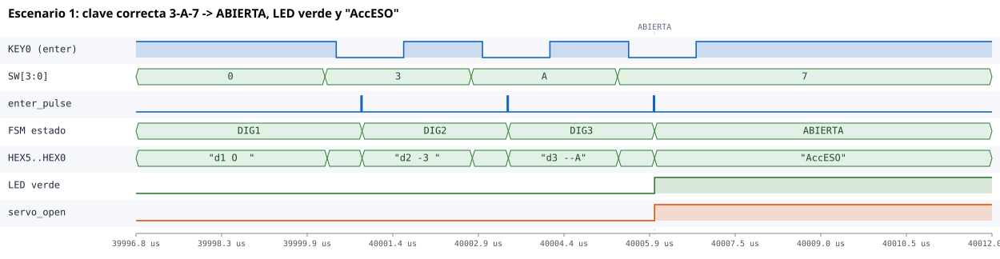
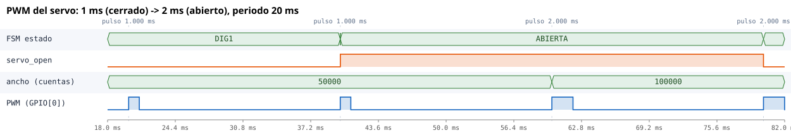
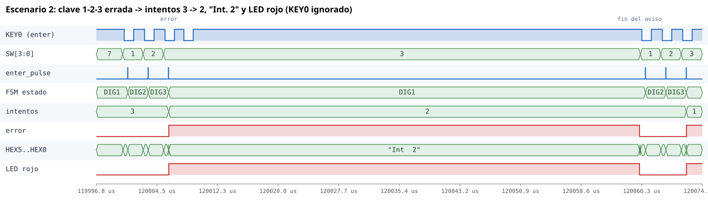
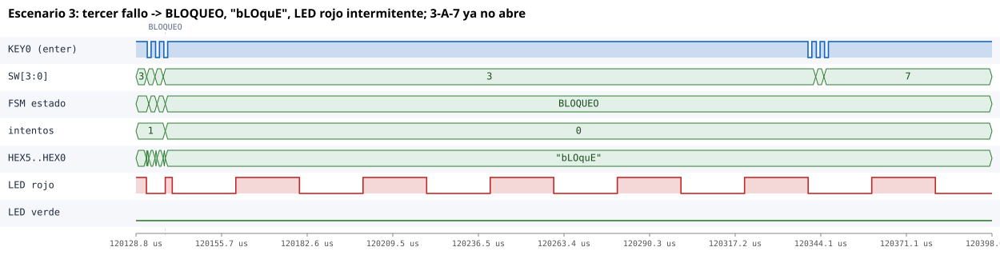

# Informe Lab 06: Caja Fuerte Digital — FSM con cerrojo de servomotor en FPGA (DE10-Lite)

**Universidad ECCI**
**Facultad de Ingeniería — Electrónica Digital**

**Autor:** Carlos Rafael Herrera Gamarra

---

Cerradura electrónica que valida una **combinación de 3 dígitos hexadecimales** con una **FSM tipo Moore** en la DE10-Lite (MAX 10). Si la clave es correcta, un **servomotor SG90** abre el cerrojo. Si la clave es incorrecta, se descuenta un intento, y con tres fallos la caja se **bloquea**.

| Entrada / salida | Función |
|---|---|
| `SW3..SW0` | Dígito de la clave (0–F) |
| `KEY0` | *Enter*: confirma el dígito (con la caja abierta, la cierra) |
| `KEY1` | Reset maestro: vuelve al inicio con 3 intentos (sale de `BLOQUEO`) |
| `GPIO[0]` | PWM del servo, 50 Hz: 1 ms cerrado / 2 ms abierto |
| `GPIO[1]` / `GPIO[2]` | LED **verde** / LED **rojo** externos |
| `HEX5..HEX0` | Mensajes: `d1 X`, `AccESO`, `Int.  n`, `bLOquE` |
| `LEDR2..LEDR0` | Intentos restantes (barra) |

**Combinación secreta:** `3 - A - 7` (`0011 1010 0111`).

---

## 1. Estructura del repositorio

```
caja_fuerte.v          Módulo superior: integra todo y asigna los pines de la DE10-Lite
fsm_caja_fuerte.v      FSM Moore de la caja fuerte
servo_pwm.v            Generador PWM de 50 Hz para el servo (1 ms / 2 ms)
msg_display.v          Mensajes en los 6 displays de 7 segmentos
debounce.v             Sincronizador + antirrebote + detector de flanco de los KEY
clk_divider.v          Divisor de frecuencia (parpadeo de 1 Hz del LED rojo)
tb_caja_fuerte.v       Testbench de la FSM sola
tb_caja_fuerte_top.v   Testbench autoverificable del sistema completo (mide el PWM)
sim/
  run_sim.bat              Compila, simula los dos testbench y genera las figuras
  waves.py                 Dibuja las formas de onda del VCD en SVG
  tb_caja_fuerte_top.gtkw  Vista preconfigurada para GTKWave
docs/img/              Formas de onda de la simulación
caja_fuerte.qpf/.qsf/.sdc  Proyecto de Quartus con los pines asignados
output_files/caja_fuerte.sof  Archivo para programar la placa
```

---

## 2. Diseño

### 2.1 Diagrama de bloques



### 2.2 Diagrama de estados (Moore)

Las salidas van **dentro de cada estado** y las flechas solo llevan la condición de transición. `E` = pulso de `KEY0` (enter), `M` = pulso de `KEY1` (reset maestro), `ok` = los 3 dígitos coinciden con la clave, `n` = intentos restantes.



Desde **cualquier** estado, `M` (o el reset de encendido) lleva a `S_DIG1` con 3 intentos.

### 2.3 Tabla de estados y salidas

| Estado | Cód. | Servo | LED verde | LED rojo | HEX5..HEX0 | Descripción |
|---|:---:|:---:|:---:|:---:|:---:|---|
| `S_DIG1` | `000` | cerrado | 0 | 0 | `d1 X  ` | Esperando el dígito 1 (`X` = valor de los switches) |
| `S_DIG2` | `001` | cerrado | 0 | 0 | `d2 -X ` | Dígito 1 capturado, se muestra oculto (`-`) |
| `S_DIG3` | `010` | cerrado | 0 | 0 | `d3 --X` | Dígito 2 capturado |
| `S_ABIERTA` | `011` | **abierto** | **1** | 0 | `AccESO` | Combinación correcta |
| *(aviso de error)* | — | cerrado | 0 | **1** | `Int.  n` | Clave errada: `n` intentos restantes, durante 2 s |
| `S_BLOQUEO` | `100` | cerrado | 0 | **1 Hz** | `bLOquE` | Intentos agotados |

### 2.4 Correspondencia con los 7 estados de la guía

La FSM implementada tiene **5 estados**. Los otros dos de la guía están cubiertos así:

| Guía | Implementación | Comentario |
|---|---|---|
| `S_INICIO` | `S_DIG1` | Reposo, esperando el dígito 1 |
| `S_CAP1` | `S_DIG2` | Dígito 1 capturado |
| `S_CAP2` | `S_DIG3` | Dígito 2 capturado |
| `S_VERIF` | transición desde `S_DIG3` | La comparación de los 3 dígitos se hace en el mismo flanco en que llega el tercer `KEY0`, con la clave completa |
| `S_ABIERTO` | `S_ABIERTA` | — |
| `S_ERROR` | aviso de error en `caja_fuerte.v` | La FSM descuenta el intento y vuelve a `S_DIG1`. El módulo superior detecta que `attempts_left` bajó y muestra `Int.  n` con el LED rojo durante 2 s, ignorando `KEY0` mientras tanto |
| `S_BLOQUEO` | `S_BLOQUEO` | Solo sale con `KEY1` |

### 2.5 Condiciones de transición

| Desde | Condición | Hacia | Acción |
|---|---|---|---|
| `S_DIG1` | pulso `KEY0` | `S_DIG2` | `dig1 ← SW` |
| `S_DIG2` | pulso `KEY0` | `S_DIG3` | `dig2 ← SW` |
| `S_DIG3` | pulso `KEY0` y `{dig1, dig2, SW} = clave` | `S_ABIERTA` | intentos ← 3 |
| `S_DIG3` | pulso `KEY0`, clave errada, intentos > 1 | `S_DIG1` | intentos ← intentos − 1 |
| `S_DIG3` | pulso `KEY0`, clave errada, intentos = 1 | `S_BLOQUEO` | intentos ← 0 |
| `S_ABIERTA` | pulso `KEY0` | `S_DIG1` | cierra la caja |
| cualquiera | pulso `KEY1` | `S_DIG1` | intentos ← 3 |

### 2.6 Estructura del código

**FSM (`fsm_caja_fuerte.v`).** La clave entra por parámetros (`CLAVE_1..3`), y el módulo superior la fija en `3-A-7`. El código tiene:
- un `always @(posedge clk or negedge reset_n)` con el registro de estado, los dígitos guardados (`dig1`, `dig2`) y el contador de intentos. La lógica de próximo estado está dentro del mismo `case`;
- un `always @(*)` con las salidas Moore, que dependen **solo** de `state`. Empieza con valores por defecto para no inferir latches.

El tercer dígito no se guarda: se compara directamente contra `switches` en el flanco del tercer `KEY0`, junto con `dig1` y `dig2`. Así la comparación se hace **al final**, con la clave completa.

**Módulo superior (`caja_fuerte.v`).** Conecta la FSM a la placa y agrega:
- **Reset de encendido** de 8 ciclos, para que la FSM arranque en `S_DIG1` con 3 intentos.
- **Antirrebote** de 10 ms en `KEY0` y `KEY1` (`debounce.v`), y un **sincronizador** de 2 flip-flops en `SW3..SW0`.
- **Aviso de error:** cuando `attempts_left` baja y todavía quedan intentos, `error = 1` durante `ERROR_CYCLES` (2 s). En ese tiempo se muestra `Int.  n`, se enciende el LED rojo y se ignora `KEY0`.
- **Parpadeo:** `clk_divider` genera un tick de 2 Hz y un flip-flop `blink` cambia con cada tick (1 Hz). El LED rojo es `error | (led_red & blink)`.

### 2.7 Control del servomotor (`servo_pwm.v`)

Con el reloj de 50 MHz (20 ns por ciclo):

```
Periodo 20 ms ->  20 ms / 20 ns = 1 000 000 cuentas  -> contador de 20 bits (2^20 = 1 048 576)
Pulso    1 ms ->   1 ms / 20 ns =    50 000 cuentas  -> ~0°  (cerrado)
Pulso    2 ms ->   2 ms / 20 ns =   100 000 cuentas  -> ~90° (abierto)
```

`pwm = 1` mientras `cnt < width`, y `width` vale 50 000 (cerrado) o 100 000 (abierto). `width` solo se actualiza al comenzar un periodo, así nunca sale un pulso recortado cuando cambia `servo_open`.

### 2.8 Mensajes en los displays (`msg_display.v`)

Los displays de la DE10-Lite son activos en bajo (`{dp, g, f, e, d, c, b, a}`). Todos los caracteres de los mensajes se pueden representar en 7 segmentos:

| Mensaje | Cuándo |
|---|---|
| `d1 X  ` / `d2 -X ` / `d3 --X` | Ingreso de la clave. `HEX4` dice qué dígito se pide, cada dígito ya capturado se oculta con `-` y `X` es el valor actual de los switches |
| `AccESO` | Acceso concedido |
| `Int.  n` | Clave errada, quedan `n` intentos (punto decimal de `HEX3` encendido) |
| `bLOquE` | Caja bloqueada |

---

## 3. Simulación

Requisitos: Icarus Verilog y Python (solo para las figuras).

```bat
sim\run_sim.bat          :: simula los dos testbench y genera docs\img\*.svg
sim\run_sim.bat wave     :: además abre GTKWave con las señales cargadas
```

### 3.1 Testbench de la FSM (`tb_caja_fuerte.v`)

```
PRUEBA 1: CLAVE CORRECTA
CORRECTO: CAJA ABIERTA
PRUEBA 2: PRIMER ERROR
CORRECTO: QUEDAN 2 INTENTOS
PRUEBA 3: SEGUNDO ERROR
CORRECTO: QUEDA 1 INTENTO
PRUEBA 4: TERCER ERROR
CORRECTO: CAJA BLOQUEADA
FIN DE LAS PRUEBAS
```

### 3.2 Testbench del sistema completo (`tb_caja_fuerte_top.v`)

Simula `caja_fuerte.v` con el **reloj real de 50 MHz**, así los tiempos del PWM son los reales. Solo se acortan el antirrebote (20 ciclos), el aviso de error (60 µs) y el parpadeo (40 µs), que en la placa duran milisegundos o segundos. Los displays se decodifican a texto para verificar los mensajes, y el ancho de cada pulso PWM se mide en milisegundos.

```
=== Encendido ===
Inicia esperando el digito 1 con 3 intentos  PASS
Display: "d1 X" con el valor de los switches  PASS
   PWM: pulso = 1.000 ms, periodo = 20.000 ms
Servo CERRADO: pulso de 1 ms cada 20 ms  PASS
=== Escenario 1: combinacion correcta 3-A-7 ===
Digito 1 capturado, se oculta con "-"  PASS
Digito 2 capturado  PASS
Estado ABIERTO con mensaje "AccESO"  PASS
LED verde encendido, LED rojo apagado  PASS
   PWM: pulso = 2.000 ms, periodo = 20.000 ms
Servo ABIERTO: pulso de 2 ms cada 20 ms  PASS
KEY1 cierra la caja y vuelve al inicio  PASS
   PWM: pulso = 1.000 ms, periodo = 20.000 ms
El servo vuelve a CERRADO (1 ms)  PASS
=== Escenario 2: combinacion incorrecta 1-2-3 ===
ERROR: LED rojo encendido  PASS
Se descuenta un intento (quedan 2)  PASS
Display "Int.  2"  PASS
KEY0 se ignora mientras se muestra el error  PASS
Termina el aviso y pide de nuevo el digito 1  PASS
Segundo error: "Int.  1"  PASS
=== Escenario 3: tres fallos ===
Estado BLOQUEO con mensaje "bLOquE"  PASS
LED rojo parpadea en BLOQUEO  PASS
En BLOQUEO ni la clave correcta abre  PASS
   PWM: pulso = 1.000 ms, periodo = 20.000 ms
Servo sigue CERRADO (1 ms)  PASS
KEY1 (reset maestro) sale de BLOQUEO  PASS
Tras el reset la clave correcta abre de nuevo  PASS
--------------------------------------------------------------
 RESULTADO: 22 pruebas, TODAS PASARON
```

### 3.3 Escenario 1: combinación correcta

Con cada pulso de `KEY0` la FSM avanza un dígito. Los dígitos ya capturados se ocultan con `-`. Al tercer pulso con la clave `3-A-7`, el estado pasa a `ABIERTA`: se enciende el LED verde, se activa `servo_open` y aparece `AccESO`:



### 3.4 Ancho del pulso PWM

Mientras la caja está cerrada, el pulso dura **1,000 ms**. Al abrirse, el ancho pasa de 50 000 a 100 000 cuentas al comenzar el siguiente periodo y el pulso dura **2,000 ms**. El periodo se mantiene en **20,000 ms** (50 Hz):



### 3.5 Escenario 2: combinación incorrecta

Con `1-2-3` los intentos bajan de 3 a 2, se activa el aviso de error (`Int.  2` y LED rojo) y la FSM vuelve a pedir el dígito 1. Los pulsos de `KEY0` durante el aviso no tienen efecto. Al terminar el aviso se puede volver a intentar:



### 3.6 Escenario 3: tres fallos → bloqueo

Con el tercer fallo los intentos llegan a 0 y la FSM pasa a `BLOQUEO`: aparece `bLOquE` y el LED rojo parpadea (en la placa a 1 Hz; en la simulación más rápido). Ni siquiera la clave correcta abre la caja. Solo `KEY1` la desbloquea:



---

## 4. Implementación en la DE10-Lite

### 4.1 Compilación

Abra `caja_fuerte.qpf` en Quartus (los pines ya están asignados en el `.qsf`) y compile. Después programe `output_files/caja_fuerte.sof` con *Programmer* (USB-Blaster).

Resultado de la compilación (Quartus Prime Lite 25.1, 10M50DAF484C7G):

| Recurso | Uso |
|---|---|
| Elementos lógicos | 296 / 49 760 (< 1 %) |
| Registros | 150 |
| Pines | 74 / 360 (21 %) |
| Fmax (peor esquina, 85 °C) | 184 MHz (requerido 50 MHz, slack +14,6 ns) |

### 4.2 Asignación de pines

| Señal | Pin | Señal | Pin |
|---|---|---|---|
| MAX10_CLK1_50 | P11 | KEY0 (enter) / KEY1 (reset) | B8 / A7 |
| SW0…SW3 | C10, C11, D12, C12 | LEDR0…LEDR9 | A8, A9, A10, B10, D13, C13, E14, D14, A15, B11 |
| HEX0[0..7] | C14, E15, C15, C16, E16, D17, C17, D15 | HEX1[0..7] | C18, D18, E18, B16, A17, A18, B17, A16 |
| HEX2[0..7] | B20, A20, B19, A21, B21, C22, B22, A19 | HEX3[0..7] | F21, E22, E21, C19, C20, D19, E17, D22 |
| HEX4[0..7] | F18, E20, E19, J18, H19, F19, F20, F17 | HEX5[0..7] | J20, K20, L18, N18, M20, N19, N20, L19 |
| **GPIO[0]** servo (PWM) | **V10** | **GPIO[1]** LED verde | **W10** |
| **GPIO[2]** LED rojo | **V9** | | |

### 4.3 Conexión del servo y los LEDs

| Header GPIO (JP1) | Conectar |
|---|---|
| Pin 1: GPIO[0] | Señal del servo SG90 (cable **naranja**) |
| Pin 2: GPIO[1] | LED **verde** + resistencia de 220–330 Ω |
| Pin 3: GPIO[2] | LED **rojo** + resistencia de 220–330 Ω |
| Pin 12 (o 30): **GND** | Cátodos de los LEDs, cable **café** del servo y **negativo de la fuente de 5 V** |
| Fuente externa de 5 V | Cable **rojo** del servo (positivo) |

> ⚠️ El servo **no** se alimenta desde la FPGA. Solo comparte la **GND**. Los GPIO trabajan a 3,3 V, y el SG90 acepta 3,3 V como nivel alto en la señal de control. Verifique la numeración del header en el manual de la DE10-Lite antes de conectar.

### 4.4 Prueba

1. Programar la placa: el display muestra `d1 X` y `LEDR2..LEDR0` están encendidos (3 intentos). El servo queda en la posición de cerrado.
2. Ingresar `3`, `A`, `7` (cada uno con `SW3..SW0` y `KEY0`): el servo gira a ~90°, se enciende el LED verde y aparece `AccESO`.
3. Presionar `KEY0` o `KEY1`: la caja se cierra.
4. Ingresar una clave errada: aparece `Int.  2`, se enciende el LED rojo durante 2 s y se apaga un LED de la barra de intentos.
5. Fallar tres veces: aparece `bLOquE`, el LED rojo parpadea a 1 Hz y la clave correcta ya no abre la caja.
6. Presionar `KEY1`: la caja se desbloquea con 3 intentos.

### 4.5 Evidencias

> Pendiente: agregar en `docs/evidencias/` las fotos y el video de la maqueta mostrando la apertura con la clave correcta, la realimentación de intentos y el bloqueo.

---

## 5. Preguntas de análisis

**1. ¿Por qué esta FSM es tipo Moore? ¿Cómo se vería si fuera Mealy?**
Las salidas (servo, LEDs, modo del display) se calculan en un `always @(*)` que depende **solo** del estado. Por eso cambian únicamente en el flanco de reloj en que cambia el estado y no tienen glitches por cambios de las entradas. En una **Mealy**, las salidas se escribirían en las flechas (`E·ok / abrir`) y dependerían también de las entradas. Por ejemplo, el servo podría abrirse en el mismo ciclo en que llega el tercer `KEY0` con la clave correcta, sin esperar al estado `ABIERTA`, y algunos estados se podrían fusionar. A cambio, la salida sería combinacional con las entradas del usuario: un rebote o un cambio en los switches se vería directamente en la salida.

**2. ¿Cuántos flip-flops necesita la codificación de estado con 7 estados? ¿Y con one-hot?**
- **Binaria:** ⌈log₂ 7⌉ = **3 flip-flops**. **One-hot:** **7 flip-flops**, uno por estado.
- La FSM implementada tiene 5 estados: también **3** en binario y **5** en one-hot.

Se sintetizó el diseño con las dos codificaciones (`STATE_MACHINE_PROCESSING` en Quartus):

| Codificación | Flip-flops de estado | Registros totales | Elementos lógicos |
|---|---|---|---|
| Binaria mínima (`MINIMAL BITS`) | 3 | 148 | 288 |
| One-hot (la que Quartus elige en `Auto`) | 5 | 150 | 296 |

En este diseño la binaria resulta un poco más pequeña, porque la FSM entrega el código del estado como `display_mode` y con one-hot hay que volver a codificarlo. En general, one-hot gasta más flip-flops pero simplifica la lógica de próximo estado. En una FPGA los flip-flops sobran, por eso Quartus usa one-hot por defecto.

**3. Cuentas para los pulsos de 1 ms y 2 ms con 50 MHz, y tamaño del contador del PWM.**
Con T = 1/50 MHz = 20 ns:
- 1 ms / 20 ns = **50 000 cuentas**.
- 2 ms / 20 ns = **100 000 cuentas**.
- Periodo: 20 ms / 20 ns = **1 000 000 cuentas**. Se necesita ⌈log₂ 1 000 000⌉ = **20 bits**, porque 2¹⁹ = 524 288 < 1 000 000 ≤ 2²⁰ = 1 048 576.

La simulación lo confirma: pulsos de 1,000 ms y 2,000 ms con un periodo de 20,000 ms.

**4. ¿Por qué conviene comparar la combinación al final y no dígito por dígito?**
Si se compara dígito por dígito y la FSM reacciona apenas un dígito falla, el usuario sabe **cuál** dígito está mal. Así puede adivinar la clave dígito por dígito: como máximo 16 + 16 + 16 = 48 pruebas en lugar de 4096. Comparando al final, la respuesta es solo "correcta" o "incorrecta", sin información parcial, y hay que probar combinaciones completas. Además, el tiempo de respuesta es el mismo sin importar cuál dígito falló, así que no se filtra información por tiempo.

**5. ¿Cuántas combinaciones distintas son posibles con 3 dígitos de 4 bits? ¿Cómo aumentaría la seguridad?**
Cada dígito tiene 2⁴ = 16 valores: 16³ = 2¹² = **4096 combinaciones**. Con 3 intentos antes del bloqueo, la probabilidad de acertar al azar es 3/4096 ≈ 0,07 %. Para aumentar la seguridad:
- Usar más dígitos: con 4 dígitos son 16⁴ = 65 536, y con 6 dígitos 16⁶ ≈ 16,8 millones.
- Mantener el bloqueo tras pocos intentos, o agregar un tiempo de espera creciente entre intentos.
- No mostrar los dígitos ingresados en el display (ya se ocultan con `-`).
- Permitir cambiar la clave y guardarla en memoria en lugar de fijarla en el código.

**6. ¿Por qué es necesario sincronizar y antirrebotar las entradas del usuario?**
- **Sincronizar:** los botones y switches cambian en cualquier momento, sin relación con el reloj. Si un flip-flop muestrea la entrada justo cuando cambia, puede quedar **metaestable**, y distintas partes de la FSM pueden ver valores distintos de la misma señal. Los 2 flip-flops en cadena dan tiempo para que la señal se estabilice.
- **Antirrebotar:** un botón mecánico rebota durante unos milisegundos al presionarlo. A 50 MHz cada rebote se vería como una pulsación distinta: con una sola pulsación la FSM capturaría varios dígitos seguidos (el mismo valor en `d1`, `d2` y `d3`) y consumiría intentos sin que el usuario lo quiera. El antirrebote exige que el nivel se mantenga 10 ms, y el detector de flanco entrega **un solo pulso** por pulsación.

**7. ¿Por qué el servo no debe alimentarse desde la FPGA?**
- El SG90 consume entre 100 y 250 mA al moverse, y más de 600 mA con el eje bloqueado. Un pin GPIO entrega solo unos mA, y los rieles de la tarjeta no están pensados para cargas inductivas.
- El motor genera picos de corriente y ruido que pueden bajar el voltaje de la FPGA, reiniciarla o dañar los pines.
- Por eso el servo se alimenta con una **fuente externa de 5 V** y solo se une la **GND** con la FPGA, para que la señal PWM tenga la misma referencia.
