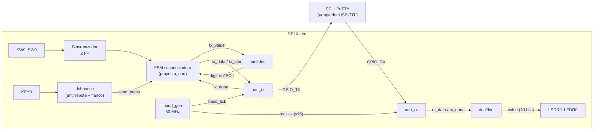
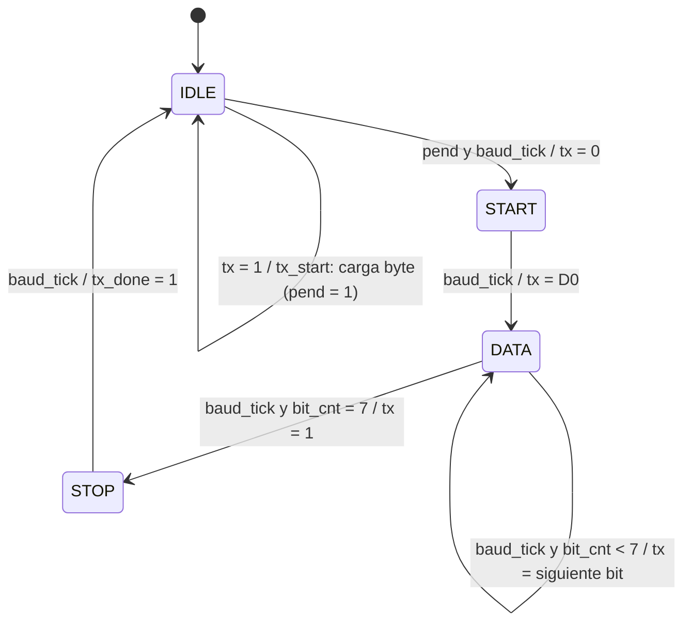
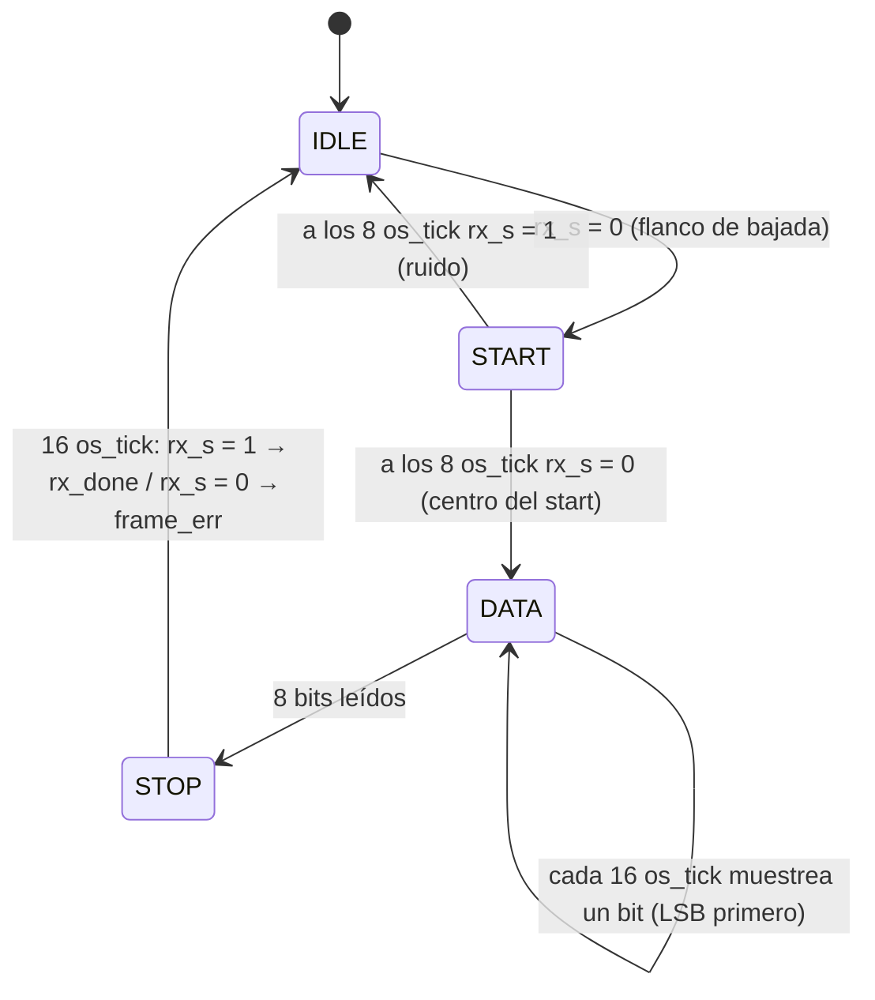
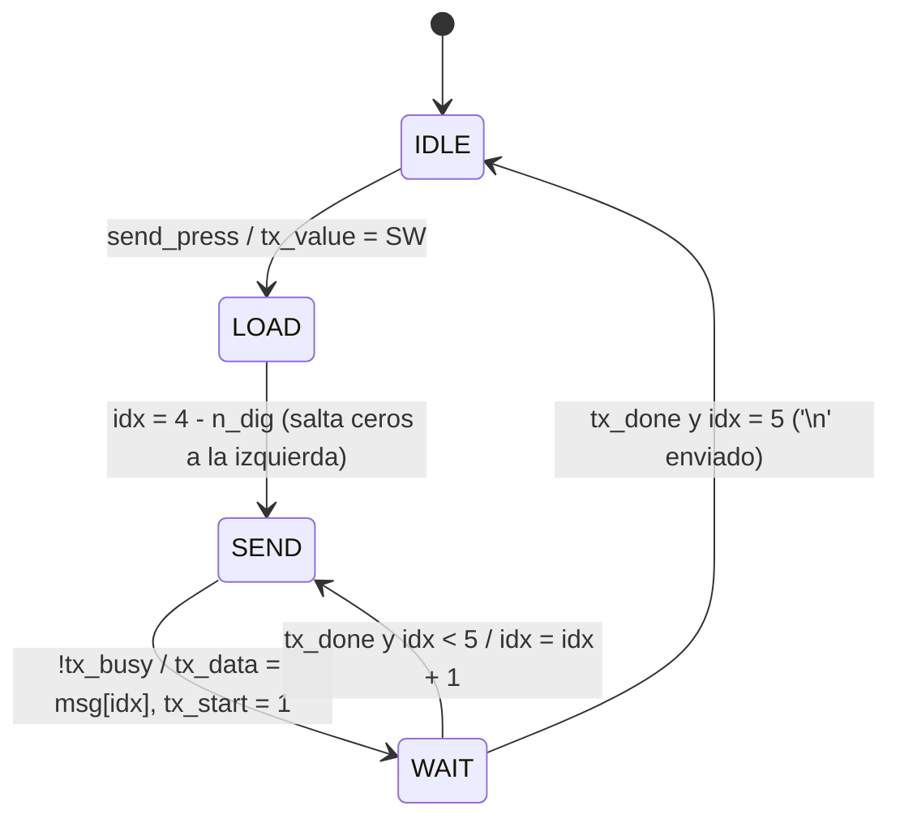
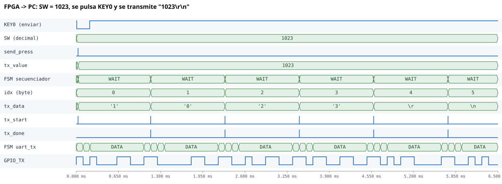
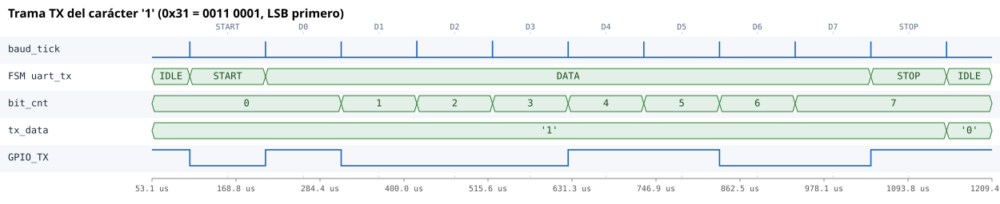
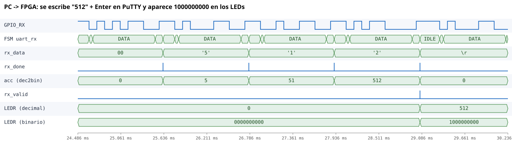
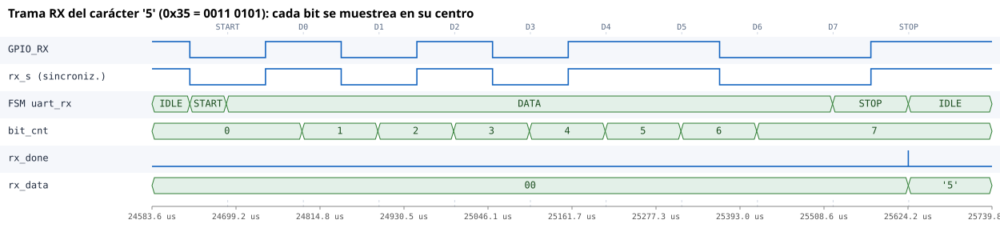
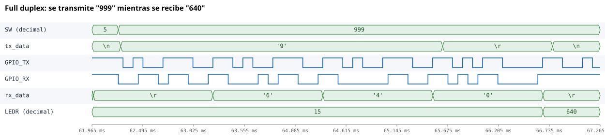

# Informe Lab 07: Proyecto Final — Enlace UART entre FPGA (DE10-Lite) y PC

**Universidad ECCI**
**Facultad de Ingeniería — Electrónica Digital**

**Autor:** Carlos Herrera

---

Enlace serial UART bidireccional entre la DE10-Lite (MAX 10) y un PC con PuTTY:

| Sentido | Qué hace el usuario | Resultado |
|---|---|---|
| **FPGA → PC** | Fija un número 0–1023 en `SW9..SW0` y presiona `KEY0` | El número se imprime en PuTTY |
| **PC → FPGA** | Escribe un número 0–1023 en PuTTY y presiona *Enter* | El número aparece en binario en `LEDR9..LEDR0` |

`KEY1` reinicia el sistema. Formato: **9600 baudios, 8-N-1**.

---

## 1. Estructura del repositorio

```
proyecto_uart.v     Módulo superior: integra todo + FSM que envía los dígitos
baud_gen.v          Generador de baudios (tick por bit y tick x16)
uart_tx.v           Transmisor UART (FSM IDLE/START/DATA/STOP)
uart_rx.v           Receptor UART con sobremuestreo x16 y sincronizador
bin2dec.v           10 bits -> 4 dígitos ASCII (double dabble)
dec2bin.v           Dígitos ASCII -> valor de 10 bits (acc*10 + dígito)
debounce.v          Sincronizador + antirrebote + detector de flanco de KEY0
tb_proyecto_uart.v  Testbench autoverificable (ambos sentidos)
sim/
  run_sim.bat          Compila, simula y genera las figuras
  waves.py             Dibuja las formas de onda del VCD en SVG
  tb_proyecto_uart.gtkw  Vista preconfigurada para GTKWave
docs/img/            Formas de onda de la simulación
proyecto_uart.qpf/.qsf/.sdc   Proyecto de Quartus con los pines asignados
```

---

## 2. Diseño

### 2.1 Diagrama de bloques



### 2.2 Trama y formato

```
  IDLE | START |  D0 D1 D2 D3 D4 D5 D6 D7  | STOP | IDLE
   1   |   0   |     8 bits (LSB primero)  |  1   |  1
```

- **9600 baudios, 8 bits de datos, sin paridad, 1 bit de stop (8-N-1)**.
- Un bit dura 1/9600 = **104,17 µs**, así que un carácter (10 bits) tarda 1,04 ms.
- Generador de baudios (`baud_gen.v`), con reloj de 50 MHz:
  - `baud_tick` (TX): N = 50 000 000 / 9600 = 5208,3 → **5208 cuentas** (error 0,006 %).
  - `os_tick` (RX, sobremuestreo x16): N = 50 000 000 / (9600·16) = 325,5 → **326 cuentas** (error 0,15 %).

### 2.3 FSM del transmisor (`uart_tx.v`)

Cada estado dura exactamente un `baud_tick`. Cuando llega `tx_start`, el byte queda pendiente y la trama arranca en el siguiente `baud_tick`. Así el bit de start mide un bit completo, aunque el divisor corra libremente.



### 2.4 FSM del receptor (`uart_rx.v`)

La línea `GPIO_RX` pasa primero por un sincronizador de 2 flip-flops (`rx_s`). Luego se sobremuestrea 16 veces por bit para leer cada bit **en su centro**:



Si el stop vale 0 (**error de trama**), el byte se descarta y el receptor espera a que la línea vuelva a 1 antes de aceptar otro start. Sin esa espera, el resto del stop en 0 se confundiría con un start nuevo y el receptor perdería la sincronización. La simulación encontró ese caso, y está corregido.

### 2.5 FSM secuenciadora del mensaje (`proyecto_uart.v`)

El mensaje que se envía es `[dígitos sin ceros a la izquierda] + "\r\n"`:



### 2.6 Conversión binario ↔ decimal

**Transmisión (`bin2dec.v`): double dabble.** Es lógica combinacional. Los 10 bits se desplazan 10 veces hacia 4 dígitos BCD, y antes de cada desplazamiento se le suma 3 a todo dígito ≥ 5. Cada dígito BCD se pasa a ASCII sumándole `0x30` (`'0'`). `n_dig` indica cuántos dígitos son significativos, para no imprimir `0037`.

| SW | Dígitos BCD | Se envía |
|---|---|---|
| 1023 | 1 0 2 3 | `'1' '0' '2' '3' \r \n` |
| 37 | 0 0 3 7 | `'3' '7' \r \n` |
| 0 | 0 0 0 0 | `'0' \r \n` |

**Recepción (`dec2bin.v`): acumulador.** Por cada carácter recibido:

| Carácter | Acción |
|---|---|
| `'0'`–`'9'` | `acc = acc·10 + (byte − 0x30)`, con `acc·10 = (acc<<3) + (acc<<1)` |
| Enter (`\r` o `\n`) | Si hubo dígitos: `LEDR = acc` y se reinicia `acc`. Una línea vacía (el `\n` de un `\r\n`) se ignora |
| Backspace / DEL | Borra el último dígito (`acc = acc/10`) |
| Otro | Se ignora |

Si el número supera 1023, se **satura a 1023** y se activa la bandera `overflow`.

### 2.7 Entradas asíncronas

- `GPIO_RX`, `SW` y `KEY` pasan por **2 flip-flops** antes de usarse.
- `KEY0` además tiene **antirrebote** (10 ms) y **detector de flanco**: cada pulsación genera un solo pulso `send_press`, sin importar cuánto tiempo se mantenga presionado.

---

## 3. Simulación

Requisitos: Icarus Verilog y Python (solo para generar las figuras).

```bat
sim\run_sim.bat          :: compila, simula y genera docs\img\*.svg
sim\run_sim.bat wave     :: además abre GTKWave con las señales cargadas
```

El testbench usa los parámetros reales (50 MHz, 9600 baudios). Hace de PC: decodifica `GPIO_TX` igual que PuTTY y escribe tramas en `GPIO_RX`. Resultado:

```
=== Sentido FPGA -> PC (switches + KEY0) ===
TX  SW=1023 -> PuTTY recibe "1023\r\n"  PASS
TX  SW=   0 -> PuTTY recibe "0\r\n"  PASS
TX  SW=  37 -> PuTTY recibe "37\r\n"  PASS
TX  SW= 512 -> PuTTY recibe "512\r\n"  PASS
TX  SW=   5 -> PuTTY recibe "5\r\n"  PASS
=== Sentido PC -> FPGA (PuTTY -> LEDs) ===
RX  "512\r" -> LEDR=1000000000 ( 512)  PASS
RX  "1023\r" -> LEDR=1111111111 (1023)  PASS
RX  "0\r\n" -> LEDR=0000000000 (   0)  PASS
RX  "7\r" -> LEDR=0000000111 (   7)  PASS
RX  "341\r" -> LEDR=0101010101 ( 341)  PASS
RX  "2048\r" (satura) -> LEDR=1111111111 (1023)  PASS
RX  "12<DEL>5\r" -> LEDR=0000001111 (  15)  PASS
RX  linea vacia -> LEDR=0000001111 (  15)  PASS
RX  trama con stop=0 -> frame_err detectado, LEDs sin cambio  PASS
=== Full duplex: ambos sentidos al mismo tiempo ===
RX  "640\r" (simultaneo) -> LEDR=1010000000 ( 640)  PASS
TX  SW= 999 -> PuTTY recibe "999\r\n"  PASS
 RESULTADO: 16 pruebas, TODAS PASARON
```

### 3.1 Sentido FPGA → PC

Con SW = 1023 se presiona KEY0. La FSM secuenciadora entrega `'1' '0' '2' '3' \r \n` al transmisor, un byte por cada `tx_done`:



Trama del carácter `'1'` (0x31 = `0011 0001`). Después del start, los bits salen LSB primero: 1,0,0,0,1,1,0,0, y al final el stop en 1:



### 3.2 Sentido PC → FPGA

Se escribe `512` + Enter. El acumulador pasa por 5 → 51 → 512, y con el `\r` el valor llega a los LEDs (`1000000000`):



Trama del carácter `'5'` (0x35 = `0011 0101`). Las líneas punteadas marcan el centro de cada bit, que es donde el receptor muestrea:



### 3.3 Full duplex

TX y RX son independientes, así que los dos sentidos funcionan a la vez:



---

## 4. Implementación en la DE10-Lite

### 4.1 Compilación

Abra `proyecto_uart.qpf` en Quartus (los pines ya están asignados en el `.qsf`) y compile. Después programe el `.sof` con *Programmer* (USB-Blaster).

Resultado de la compilación (Quartus Prime Lite 25.1, 10M50DAF484C7G):

| Recurso | Uso |
|---|---|
| Elementos lógicos | 456 / 49 760 (< 1 %) |
| Registros | 175 |
| Pines | 25 / 360 |
| Fmax (peor esquina, 85 °C) | 55,7 MHz (requerido 50 MHz, slack +2,0 ns) |

### 4.2 Asignación de pines

| Señal | Pin | Señal | Pin |
|---|---|---|---|
| MAX10_CLK1_50 | P11 | KEY0 (enviar) | B8 |
| KEY1 (reset) | A7 | | |
| SW0…SW9 | C10, C11, D12, C12, A12, B12, A13, A14, B14, F15 | LEDR0…LEDR9 | A8, A9, A10, B10, D13, C13, E14, D14, A15, B11 |
| **GPIO_TX** (GPIO[0]) | **V10** | **GPIO_RX** (GPIO[1]) | **W10** |

### 4.3 Conexión del adaptador USB-TTL (a 3,3 V)

| Header GPIO de la DE10-Lite | Adaptador USB-TTL |
|---|---|
| Pin 1: GPIO[0] = **GPIO_TX** | **RX** |
| Pin 2: GPIO[1] = **GPIO_RX** | **TX** |
| Pin 12 (o 30): **GND** | **GND** |

> ⚠️ Ponga el jumper del adaptador en **3,3 V**. No use 5 V ni RS-232. TX y RX se conectan **cruzados**. Verifique la numeración del header en la figura del manual de la DE10-Lite antes de conectar.

### 4.4 Configuración de PuTTY

1. *Session*: **Serial**, puerto `COMx` (consúltelo en el Administrador de dispositivos), **9600**.
2. *Connection → Serial*: 8 data bits, 1 stop bit, Parity **None**, Flow control **None**.
3. *Terminal*:
   - **Local echo: Force on**, para ver lo que escribe (la FPGA no hace eco).
   - **Local line editing: Force on**, para que PuTTY envíe la línea completa al presionar Enter.
   - **Implicit LF in every CR**: activado, para que cada número quede en su propia línea.

### 4.5 Prueba

1. Switches en `1111111111` → presionar KEY0 → PuTTY muestra `1023`.
2. Escribir `341` + Enter en PuTTY → LEDs `0101010101`.

---

## 5. Preguntas de análisis

**1. ¿Por qué un solo byte no alcanza para 0–1023 y cómo se resuelve?**
Un byte tiene 8 bits: 2⁸ = 256 valores (0–255). Para 1024 valores se necesitan 10 bits (2¹⁰ = 1024). El diseño envía el número **como texto**, un carácter ASCII por dígito (de 1 a 4 bytes), terminado en `\r\n`. En transmisión, `bin2dec` convierte los 10 bits a dígitos. En recepción, `dec2bin` acumula los dígitos (`acc = acc·10 + d`) hasta el Enter.

**2. Cuentas del generador de baudios para 9600 baudios con reloj de 50 MHz.**
N = 50 000 000 / 9600 = 5208,33 → **5208 cuentas** (contador de 0 a 5207). La velocidad real es 50 MHz / 5208 = 9600,6 baudios, con un error de 0,006 %. Para el receptor con sobremuestreo x16: 50 MHz / 153 600 = 325,5 → 326 cuentas (9585,9 baudios, error −0,15 %). Ambos errores están muy por debajo del ≈ ±2 % que tolera una UART.

**3. ¿Por qué el receptor es más complejo que el transmisor?**
El transmisor controla el tiempo: genera cada bit con su propio `baud_tick`. El receptor no recibe reloj y no sabe cuándo empieza la trama. Por eso tiene que sincronizar la entrada asíncrona, detectar el flanco del start, confirmar a medio bit que no fue ruido, sobremuestrear para leer cada bit en su centro (lejos de los flancos, donde la diferencia de reloj entre emisor y receptor tiene menos efecto) y validar el bit de stop.

**4. ¿Por qué se detecta el flanco del botón y no su nivel?**
Una pulsación humana dura cientos de milisegundos, es decir, millones de ciclos de 20 ns. Si se usara el nivel, la FPGA enviaría el número una y otra vez mientras el botón siga presionado. El flanco produce **un solo pulso por pulsación**. Además, el antirrebote evita que los rebotes mecánicos del contacto generen varios flancos.

**5. ¿Qué es un error de trama y cómo se detecta?**
Ocurre cuando el bit de stop no vale 1 donde debería. Puede deberse a baudios distintos en los dos extremos, a ruido o a una condición *break*. En `uart_rx.v`, el estado STOP muestrea el centro del bit de stop: si vale 0, activa `frame_err`, descarta el byte y espera a que la línea vuelva a reposo antes de buscar otro start. La simulación lo verifica enviando un `'9'` con stop = 0.

**6. ¿Por qué hay que sincronizar `RX` antes de usarla en la FSM?**
`RX` cambia sin relación con el reloj de 50 MHz. Si cambia justo en la ventana de *setup/hold* de un flip-flop, este puede quedar **metaestable**. Además, distintos flip-flops de la FSM podrían leer valores diferentes de la misma señal y llevar la máquina a un estado incoherente. Dos flip-flops en cascada dan un ciclo completo para que la metaestabilidad se resuelva, y entregan a la FSM una señal estable y alineada con el reloj.

**7. ¿Qué diferencia hay entre enviar el número en binario crudo y como texto ASCII?**
- **Binario crudo**: 1023 cabe en 2 bytes (`0x03 0xFF`). Es compacto y no necesita conversión, pero PuTTY mostraría caracteres de control o basura en lugar de "1023". Además, el usuario no podría escribirlo desde el teclado, y hace falta un protocolo para saber cuál byte es el alto y dónde empieza cada número.
- **Texto ASCII**: usa de 1 a 4 bytes más el terminador. Es legible y se puede escribir directamente en cualquier terminal, y el `\r\n` delimita cada número sin ambigüedad. A cambio, requiere la conversión binario ↔ decimal en hardware (`bin2dec` y `dec2bin`).
